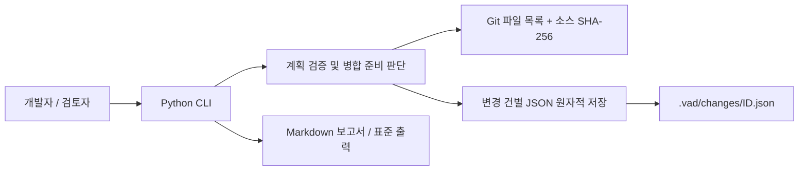

# VAD 로컬 CLI — 아키텍처 및 개발 계획

상태: MVP 개발 계획. 방법론의 핵심 버전은 Draft 0.1을 유지한다.
기준: [RFC 0003](../rfcs/0003-verification-decisions.md).

## 1. 요구사항 계약

개발자가 Git 저장소에서 변경 목적, 수용 기준, 영향 분석, 검증 결과와
사람의 승인 기록을 함께 관리한다. Python 표준 라이브러리와 Git만 사용한다.
Python 3.9 이상과 최초 커밋이 있는 Git 저장소를 대상으로 한다.

| ID | 완료 기준 |
| --- | --- |
| AC-1 | 변경 건을 생성하고 JSON 계획에 요구사항·영향·환경·복구 방법을 기록한다. 기존 변경 건을 덮어쓰지 않는다. |
| AC-2 | 계획의 수용 기준과 검증 항목을 연결한다. 필수 항목이 비면 준비 완료로 판단하지 않는다. |
| AC-3 | Pass, Fail, Blocked, Not run, N/A를 구분한다. 결과와 근거를 누적 보존한다. |
| AC-4 | 소스·계획·환경 설명 변경 후 과거 검증과 승인은 현재 결과로 재사용하지 않는다. |
| AC-5 | 최신 검증에 누락·실패가 있으면 승인을 거절한다. N/A에는 범위상 해당하지 않는 이유를 기록한다. |
| AC-6 | 현재 변경본에 대해 승인자 이름을 기록하고 Markdown 보고서를 출력한다. 기록 뒤 검증 결과가 바뀌면 승인도 재확인한다. |
| AC-7 | 잘못된 ID·손상된 데이터·동시 쓰기·심볼릭 링크 저장소에 안전하게 실패하고 기존 데이터를 보존한다. |

MVP는 단일 개발자가 사용하는 **병합 검토 기록 도구**다. 테스트 실행·배포·인증을
대행하지 않는다. 사람이 실행한 검증의 결과와 근거 위치를 명시적으로 입력한다.
입력한 Pass가 사실인지, 근거가 충분한지는 사람이 검토한다. Low/Medium의 병합
승인만 지원하며 High/Critical은 기록·조회·보고만 지원한다. 잔여 위험 예외 승인과
배포 준비 완료 판단은 구현하지 않는다. 공인 VAD 준수 인증이 아니다.

## 2. 변경 전 영향 분석

기존 저장소는 Markdown 문서와 예제 뼈대만 있으며 실행 코드·테스트·패키지 설정은 없다.
따라서 새 CLI와 테스트만 실행 경로를 갖는다. 기존 화면·API·업무 데이터·권한은
변경하지 않는다. README에는 실행 도구의 진입 링크만 추가한다.

| 변경 파일 | 이유 | 주요 위험 | 검증 |
| --- | --- | --- | --- |
| `tools/vad.py` | 명령, 계획 검증, 상태 판단, 저장, 보고 | 데이터 손실·잘못된 준비 완료 | AC-1~7 단위 및 실제 CLI 통합 검증 |
| `tests/test_vad.py` | 임시 Git 저장소에서 회귀 방지 | 테스트가 실제 호출과 다름 | 공개 CLI를 subprocess로 실행 |
| `tools/README.md` | 설치·입력 구조·사용 순서·제약 안내 | 사용자가 기록을 검증 자체로 오인 | 문서의 명령을 실행하는 시나리오 |
| 이 문서, 한·영 README | 계획·아키텍처·진입점 | 문서와 구현 불일치 | 로컬 링크·명령·범위 확인 |

구현 전 기준 검증: 기존 Markdown 링크와 Git 변경 상태를 확인한다. 실행 코드가
없으므로 기존 앱 빌드나 화면 검증은 해당하지 않는다. 구현 후 새 실행 경로 전체를
담당하는 작은 테스트 모음을 실행한다. 관계없는 환경 전체 테스트는 추가하지 않는다.

## 3. 아키텍처 결정

단일 파일 CLI 안에 명령 처리, 검증, 저장 함수를 둔다. 별도 서비스 계층·DB·웹 서버·
AI SDK는 필요하지 않다. 파일은 Git diff로 검토할 수 있고, 사용자가 선택해 커밋한다.
기존 다섯 산출물의 정보를 계획·결과·승인 레코드로 묶는 참조 구현이며 새 방법론
단계나 필수 산출물을 추가하지 않는다. ADR이 필요한 결정은 기존 템플릿을 링크한다.

### 데이터와 실행 흐름

1. `init`: `.vad/changes/ID.json`에 미완성 계획을 만든다. 최초 상태는 Not ready다.
2. 사용자가 `plan`을 편집한다: 목적·소유자·위험·수용 기준·영향·검증·환경·복구.
3. `record`: 명시한 검증 항목에 결과·관찰·근거 위치·시각·변경본 지문을 추가한다.
4. `status`: 현재 지문과 맞는 최신 결과를 확인한다. 누락·오래된 증거는 준비 미완료다.
5. `approve`: Low/Medium이고 모든 항목이 현재 Pass/N/A일 때만 병합 승인 기록을 추가한다.
6. `report`: 계획·누적 증거·승인을 Markdown으로 출력한다.

계획, 결과, 승인은 하나의 JSON 객체로 저장한다. `schema_version: 1`로 형식을
고정하고 지원하지 않는 버전은 거절한다. 결과·승인 명령은 이전 항목을 삭제하지 않는다.

### 변경본과 승인 유효성

소스 지문은 Git이 추적하거나 무시하지 않은 파일의 경로·내용·실행 비트·링크 대상
문자열을 해시한다. `.vad/`는 기록 자체가 증거를 무효화하지 않도록 제외한다.
추적 파일 삭제와 미추적 파일 추가도 반영한다. 충돌 중인 인덱스와 서브모듈은 거절한다.
HEAD SHA는 참고로 기록하지만 동일한 소스의 단순 커밋은 지문을 바꾸지 않는다.

소스 지문과 계획 전체(환경 설명 포함)의 해시가 결과의 문맥이다. 보수적으로
전체 소스·계획 변경 시 모든 검증을 다시 기록한다. 부분 증거 재사용은 후속 과제다.
승인은 현재 문맥과 전체 결과 이력에 연결한다. 이후 결과 추가도 재승인을 요구한다.
Git 무시 파일, 외부 심볼릭 링크의 실제 내용, 실행 중인 서비스·설치 패키지는 자동
감지하지 않는다. 관련 변경 시 환경 설명을 갱신하고 다시 검증해야 한다.

### 저장·신뢰 경계

ID는 영문·숫자·밑줄·하이픈으로 제한한다. `.vad`와 하위 저장 경로의 심볼릭
링크를 거절한다. 쓰기 잠금은 `.vad/.lock` 디렉터리로 획득하고, 임시 파일 작성 후
원자적으로 교체한다. 실패 시 기존 JSON을 유지한다. 프로세스 강제 종료 후 남은
잠금은 실행 중인 프로세스가 없는지 확인한 사람이 제거한다.

기록은 사용자 편집 가능한 로컬 파일이다. 악의적 수정 방지, 전자 서명, 인증된
승인자 구분은 제공하지 않는다. CLI는 승인자가 실제 사람인지 증명할 수 없다.
명령·관찰·근거에는 비밀값을 넣지 않는다. 원본 로그나 인증 정보는 자동 수집하지 않는다.
CLI를 사용하는 동안 소스 편집·검증 실행·다른 Git 작업을 병행하지 않는다. 이 잠금은
VAD 기록 쓰기만 직렬화하며 다른 편집기를 잠그지 않는다.

## 4. 구현 순서 및 검증 계획

1. 계획과 데이터 형식 고정: 미완성 계획의 승인 거절을 먼저 정의한다.
2. CLI 및 파일 저장: 생성, 조회, 누적 결과, Markdown 출력 구현.
3. 문맥 지문과 승인 규칙: 오래된 결과·누락·실패·고위험 승인 차단.
4. 임시 Git 저장소 통합 검증: 정상 흐름, 입력 오류, 이력 보존, 소스·계획 변경,
   검증 추가 후 재승인, 저장 경로·잠금·손상 데이터 보호.
5. 실제 저장소에서 도움말·안전한 조회와 문서 링크를 확인한 뒤 GitHub에 커밋·푸시.

공개 명령: `init`, `record`, `status`, `approve`, `report`.
설치 없는 실행: `python3 tools/vad.py --help`.
테스트: `PYTHONDONTWRITEBYTECODE=1 python3 -m unittest discover -s tests -v`.

## 5. 복구 및 후속 범위

도입은 파일 추가이므로 CLI 사용을 중단하면 기존 개발 흐름으로 복귀한다. 기록이
커밋되어 있으면 Git에서 복원한다. 파괴적 자동 롤백·배포는 수행하지 않는다.

팀 공동 사용이 실제로 필요하면 인증·서명·정책·CI 연결을 설계하고, 그때 웹 UI와
고위험 검토·예외 승인·배포 관문을 확장한다. MVP 완료 여부와 검증 결과는 구현 후
기록하며, 이 계획만으로 구현이나 검증이 완료되었다고 주장하지 않는다.

## 6. MVP 구현 및 검증 결과

2026-11-17 기준 `init`, `record`, `status`, `approve`, `report`를 구현했다.
검증 환경은 이 작업의 macOS, Python 3.13.2, Git 2.50.1이다.

| 검증 | 관찰 결과 | 한계 |
| --- | --- | --- |
| `PYTHONDONTWRITEBYTECODE=1 python3 -m unittest discover -s tests -v` | 임시 Git 저장소의 실제 CLI 호출 및 원자적 저장 실패 검증 18개 통과 | 외부 서비스나 운영 환경을 검증하지 않음 |
| `python3 tools/vad.py --help` | 공개 명령과 인자 안내 정상 출력 | 대화형 UI 없음 |
| Python AST의 `feature_version=(3, 9)` 파싱 | CLI·테스트 구문 통과 | Python 3.9 런타임은 실행하지 않음 |
| Markdown 로컬 링크·코드 블록·사용 안내 JSON 확인 | 링크 대상 존재, 블록 닫힘, 예제 수용 기준과 검증 항목 연결 확인 | GitHub 화면 렌더링 미검증 |
| `git diff --check` | 공백 오류 없음 | 기능 검증을 대체하지 않음 |

관찰된 결과는 개발 도구를 통해 확인한 것이며 독립적인 사람의 승인으로 표시하지 않는다.
이 MVP의 기록은 진위가 보증된 감사 자료가 아니다. 팀 인증·고위험 승인·배포 자동화는
구현 범위 밖이다. 기록 손상이나 권한 문제는 조용히 통과시키지 않고 오류로 반환한다.
